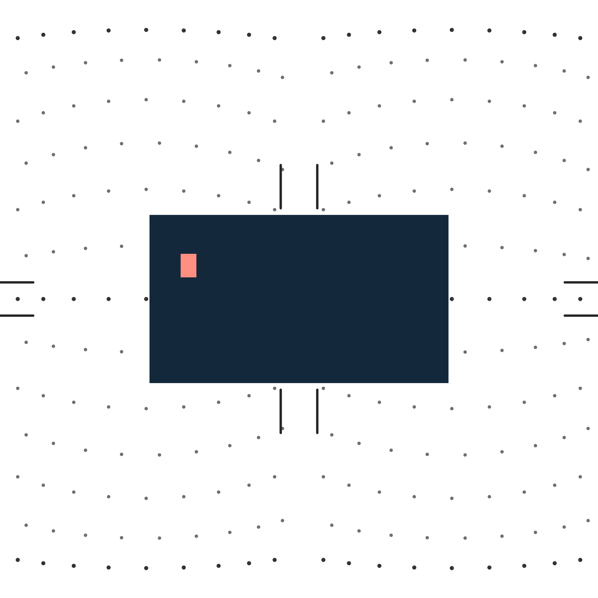

# VR180 Dot Reference Generator

Generate a **VR180 projection dot grid** from a still image. Use the Python command-line interface (CLI) or the included Codex skill to make consistent composition references for immersive video, VR storyboards, and shot previsualization.

**中文简介** · 把一张普通图片做成 VR180 投影参考点阵。自动适配 16:9、1:1 和其他画幅，适用于沉浸式视频分镜、构图预演和素材对齐。



[Download the demo input](examples/16x9-input.png) · [View the full-size dot reference](examples/16x9-expected.png)

## Projection grid and image fit

The tool produces a **2048 × 2048 PNG** with a white guide, gray dot fields, and alignment ticks. The angular guides use a 180° × 180° equirectangular coordinate system. The source image sits in the center with its longer side set to 1024 pixels. It keeps its proportions, full frame, and transparency.

| Input | Centered image | Expected result / 验收标准 |
| --- | --- | --- |
| 16:9 landscape | 1024 × 576 | The entire image fits with even space above and below. |
| 1:1 square | 1024 × 1024 | The entire image fits with equal margins on all four sides. |
| Other ratios | Long side 1024 px | The short side scales proportionally, rounded to the nearest pixel. |

The output is a production reference for framing and projection alignment. Native headset playback requires a separately rendered VR180 asset.

## Quick start

Requires **Python 3.9+** and **FFmpeg** with both `ffmpeg` and `ffprobe` on your PATH. Supported input formats are PNG, JPG, JPEG, and WebP.

```bash
git clone https://github.com/outmansam/vr180-dot-reference.git
cd vr180-dot-reference
python3 make-vr180-dot-reference/scripts/make_dot_reference.py examples/16x9-input.png -o dot-reference.png
```

On Windows, you can replace `python3` with `py -3`. The command prints the canvas dimensions, fitted image bounds, and output path. Omitting `-o` saves `<input-stem>-dot-reference.png` next to the input. An existing output file is preserved.

## Use as a Codex skill

1. Copy the entire [`make-vr180-dot-reference`](make-vr180-dot-reference/) folder into `~/.agents/skills/` (macOS and Linux) or `%USERPROFILE%\.agents\skills\` (Windows).
2. Attach an image in Codex and use one of these prompts.

> Use $make-vr180-dot-reference to make a VR180 projection dot reference from this image.

> 用 $make-vr180-dot-reference 把这张图做成投影参考点阵。

For local discovery, see the [Codex skills documentation](https://learn.chatgpt.com/docs/build-skills#where-codex-loads-local-skills). For setup, see the [FFmpeg downloads page](https://ffmpeg.org/download.html).

## License

[MIT](LICENSE).
